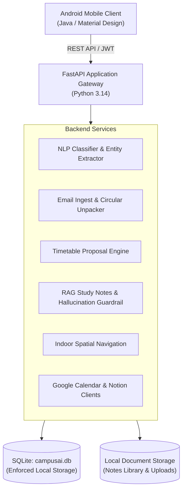

# Campus AI — Autonomous Academic Operations & Study Assistant

[](https://www.python.org/)
[](https://fastapi.tiangolo.com/)
[](https://www.sqlite.org/)
[]()
[]()

Campus AI is an intelligent academic operations platform and study assistant built for university students. It pairs a **Python FastAPI backend** with an **Android mobile client (Java/Material Design)** and a lightweight **machine learning / NLP pipeline** to automate circular categorization, schedule change extraction, timetable proposal verification, RAG study notes Q&A, and multi-floor indoor campus pathfinding.

---

## Table of Contents
- [Key Features](#key-features)
- [System Architecture](#system-architecture)
- [Repository Structure](#repository-structure)
- [Quick Start Guide](#quick-start-guide)
  - [1. Backend Setup](#1-backend-setup)
  - [2. Running the Server](#2-running-the-server)
  - [3. Running the Test Suites](#3-running-the-test-suites)
  - [4. Android App Setup](#4-android-app-setup)
- [API Documentation Overview](#api-documentation-overview)
- [Real Email Deployment Results](#real-email-deployment-results)
- [Phase Documentation Index](#phase-documentation-index)

---

## Key Features

1. **Email & Circular NLP Ingestion:**
   - 12-class categorization: `EXAM`, `ATTENDANCE`, `EVENT`, `FEES`, `ACADEMIC`, `CLASSROOM / TIMETABLE`, `ASSIGNMENT`, etc.
   - Dual-classifier urgency rating (`HIGH`, `MEDIUM`, `LOW`).
   - Automated uncertainty detection (`review_recommended=True` when confidence $< 0.45$).
   - Rule-governed information extraction for dates, times, rooms, and classroom relocations.

2. **Automated Timetable Proposals & Human-in-the-Loop:**
   - Detects classroom shifts and schedule updates from emails.
   - Automatically generates structured timetable proposals with `status="PROPOSED"`.
   - Students confirm or reject proposals with a single tap on the Android mobile client.

3. **Google Calendar & Notion Synchronization:**
   - Google Cloud OAuth 2.0 integration with `calendar.readonly` and `gmail.readonly` scopes.
   - Notion timetable database synchronization (`/api/v1/notion/sync`).
   - Zero-failure local fallback (`FALLBACK_LOCAL`) maintaining schedules in SQLite when external integrations are inactive.

4. **RAG Study Notes Chatbot:**
   - Sliding-window chunking (~450 characters, 60-character overlap) retaining original page numbers.
   - Pre-loaded Semester 5 core curriculum: Computer Networks, Operating Systems, DBMS, NLP/ML.
   - Hybrid retrieval ($70\%$ TF-IDF cosine similarity $+ 30\%$ stopword-filtered lexical overlap).
   - Strict hallucination guardrails rejecting out-of-domain queries with verified source citations.
   - Built-in campus handbook directory fallback (library, labs, attendance rules).

5. **Indoor Campus Spatial Navigation:**
   - 4-floor university building map (Ground Floor to Floor 3) with 15 core academic facilities.
   - Horizontal corridor wing guidance and cross-floor vertical stair/elevator routing.
   - Coordinate waypoints for path line rendering on the Android map canvas.

---

## System Architecture



---

## Repository Structure

```
CAMPUS AI/
├── android-app/             # Android native client application (Java / XML)
│   ├── app/src/main/java/   # Activities, Fragments, Adapters, API Retrofit client
│   └── app/src/main/res/    # Layouts, drawables, navigation, strings
├── backend/                 # FastAPI REST API Backend
│   ├── app/
│   │   ├── api/             # API Routers (auth, emails, events, calendar, campus, chat, notion)
│   │   ├── models/          # SQLAlchemy database models (user, email, event, campus, note, notion)
│   │   ├── schemas/         # Pydantic request/response validation schemas
│   │   ├── security/        # JWT auth, password hashing, and token verification
│   │   ├── services/        # Business logic (nlp_service, chat_service, campus_service, etc.)
│   │   ├── config.py        # Environment variables & application configuration
│   │   ├── database.py      # SQLite database engine & session dependency
│   │   └── main.py          # Application entrypoint & CORS middleware
│   ├── tests/               # Backend integration and unit test suites (35 tests)
│   └── client_secret.json   # Google Cloud OAuth 2.0 Web Client credentials
├── data/                    # Cleaned training dataset (1,500 academic emails)
├── docs/                    # Comprehensive phase documentation & academic reports
│   ├── phase_0_audit_report.md
│   ├── nlp_evaluation_report.md
│   ├── phase_4_evaluation_report.md
│   ├── phase_5_rag_evaluation_report.md
│   ├── phase_6_campus_navigation_report.md
│   ├── phase_7_notion_sync_report.md
│   ├── phase_8_integration_report.md
│   ├── academic_project_report.md
│   └── project_presentation_deck.md
├── nlp/                     # NLP model training, inference, and entity extraction
│   ├── classifier.py        # Intent & urgency dual Logistic Regression classifiers
│   ├── entity_extraction.py # Date, time, venue, and relocation shift extraction
│   ├── nlp_pipeline.py      # Unified analyzer entrypoint
│   └── test_nlp.py          # 16 NLP unit & held-out evaluation tests
├── storage/                 # Local filesystem storage for academic notes (.md, .pdf, .docx)
│   └── sample_notes/        # Built-in Semester 5 study notes library
└── campusai.db              # Active SQLite database file
```

---

## Quick Start Guide

### 1. Backend Setup
Activate the virtual environment in the `CAMPUS AI` directory:

```powershell
cd "CAMPUS AI"
.\.venv\Scripts\Activate.ps1
```

Install requirements (if not already installed):
```powershell
pip install -r backend/requirements.txt
```

### 2. Running the Server
Start the FastAPI server on port 8000:
```powershell
& ".\.venv\Scripts\python.exe" -m uvicorn app.main:app --app-dir backend --host 0.0.0.0 --port 8000 --reload
```
Interactive Swagger documentation is available at: **`http://localhost:8000/docs`**

### 3. Running the Test Suites
Run all 51 automated unit, integration, and end-to-end tests:

```powershell
# Run NLP Pipeline Tests (16 tests)
& ".\.venv\Scripts\python.exe" -m unittest "nlp/test_nlp.py"

# Run All Backend Tests (35 tests)
& ".\.venv\Scripts\python.exe" -m unittest discover -s "backend/tests" -p "test_*.py"
```

### 4. Android App Setup
1. Open Android Studio and select **Open** $\to$ choose `CAMPUS AI/android-app`.
2. Ensure Android SDK 34 is installed.
3. If running on the standard Android Emulator, the app connects to the FastAPI backend via `http://10.0.2.2:8000/` automatically.
4. If testing on a physical Android phone, update `BASE_URL` in `com.college.campusai.api.ApiClient` with your computer's local Wi-Fi IP (e.g., `http://192.168.1.100:8000/`).
5. Click **Run 'app'** to launch.

---

## API Documentation Overview

| Route | Method | Description |
|---|---|---|
| `/api/v1/auth/register` | POST | Register student account |
| `/api/v1/auth/login` | POST | Authenticate & receive JWT access token |
| `/api/v1/dashboard` | GET | Retrieve unified student home screen summary |
| `/api/v1/emails` | GET | List emails with category, urgency, and unread filters |
| `/api/v1/emails/sync` | POST | Ingest raw email or circular notice |
| `/api/v1/events/proposals` | GET | List pending timetable proposals awaiting action |
| `/api/v1/events/{id}/confirm` | POST | Confirm proposed timetable reschedule |
| `/api/v1/events/{id}/reject` | POST | Reject proposed timetable reschedule |
| `/api/v1/calendar/auth-url` | GET | Generate Google OAuth 2.0 authorization URL |
| `/api/v1/calendar/callback` | GET | Google OAuth 2.0 callback endpoint |
| `/api/v1/calendar/sync` | POST | Synchronize Google Calendar events into SQLite |
| `/api/v1/campus/floors` | GET | Retrieve all 4 building floors with rooms |
| `/api/v1/campus/routes` | GET | Compute turn-by-turn indoor path between rooms |
| `/api/v1/chat` | POST | Ask RAG study chatbot grounded in personal notes |
| `/api/v1/notes/upload` | POST | Upload and index study documents (.md, .pdf, .docx) |
| `/api/v1/notion/sync` | POST | Synchronize confirmed timetable with Notion |

---

## Real Email Deployment Results

In Phase 4, Campus AI was evaluated against real student email attachments from NMIMS accounts (`ANJALI.UPADHYAY43@nmims.in` and `LAKSH.GUPTA28@nmims.in`):
- **Attachments Unpacked:** 344 individual forwarded `.eml` files parsed and decoded.
- **Notices Classified:** 347 total notices ingested into SQLite:
  - Exams: 81
  - General: 75
  - Events: 65
  - Attendance Warnings: 43
  - Academic Notices: 37
  - Timetable Relocations: 20
  - Assignments: 8
  - Fees: 7
  - Registrations: 4
- **Entities Extracted:** 441 Times, 282 Dates, 171 Rooms, 163 Subjects.
- **Proposals Generated:** 115 timetable proposals created for human confirmation.

---

## Phase Documentation Index

Detailed phase evaluation reports are located in `docs/`:
- [`Phase 0: Repository Audit & Baseline Verification`](docs/phase_0_audit_report.md)
- [`Phase 1: NLP Evaluation & Baseline Report`](docs/nlp_evaluation_report.md)
- [`Phase 4: Real Email Ingestion & Deployment Report`](docs/phase_4_evaluation_report.md)
- [`Phase 5: RAG Study Notes System & Chatbot Report`](docs/phase_5_rag_evaluation_report.md)
- [`Phase 6: Campus Indoor Navigation & Pathfinding Report`](docs/phase_6_campus_navigation_report.md)
- [`Phase 7: Notion Timetable Synchronization Report`](docs/phase_7_notion_sync_report.md)
- [`Phase 8: End-to-End System Integration Report`](docs/phase_8_integration_report.md)
- [`Phase 9: Master Academic Project Report`](docs/academic_project_report.md)
- [`Phase 9: Viva Defense Presentation Deck`](docs/project_presentation_deck.md)

---
*Built with ❤️ for University Students & Academic Operations — B.Tech NLP Project 2026*
