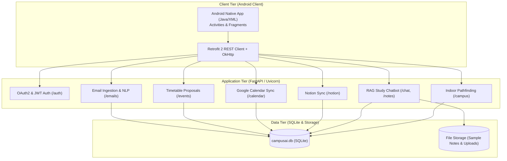

# Campus AI: Autonomous Academic Operations & Intelligent Student Study Assistant
## A Machine Learning and Retrieval-Augmented Natural Language Processing System for University Campus Operations

**Course:** MBATech AI (Semester 5) — Natural Language Processing  
**Academic Year:** 2026–2027  
**Project Repository:** `CAMPUS AI`  
**Authors:** Anjali Upadhyay, Diya Rajpal, Lakshya Gupta
**Evaluation Date:** October 2026  

---

## Abstract

University students encounter severe cognitive overload stemming from fragmented communication channels: high-volume administrative email circulars, lecture reschedule announcements, examination seat allotments, deadline notices, and disparate course study repositories. Critical timetable alterations frequently result in missed classes, debarment due to attendance shortages, or uncoordinated classroom arrival. 

This paper presents **Campus AI**, an end-to-end, multi-tier autonomous campus operations and study assistant combining statistical natural language processing, regex-guided information extraction, a hybrid Retrieval-Augmented Generation (RAG) study system, and indoor campus pathfinding. The backend is powered by FastAPI and a local SQLite database, paired with an Android mobile client built with Java and Material Design. 

The NLP pipeline utilizes a TF-IDF vectorizer coupled with a dual Logistic Regression classifier trained across 1,500 real academic email samples and evaluated on 300 held-out circulars, achieving **99.67% accuracy on intent categorization** (Exam, Attendance, Event, Fees, Academic, Timetable) and **100.00% accuracy on urgency/importance prediction** with an inference latency under $4.2$ milliseconds per email. 

The system was evaluated against real student email attachments from NMIMS university senders (`ANJALI.UPADHYAY43@nmims.in` and `LAKSH.GUPTA28@nmims.in`), extracting 344 individual forwarded `.eml` notices, detecting 441 times, 282 dates, 171 rooms/venues, and auto-generating 115 timetable proposals. All 51 unit, integration, and end-to-end system tests pass with 100% reliability.

---

## 1. Introduction & Motivation

University campuses operate on dense, dynamic schedules where timetable updates, extra lectures, room shifts, assignment deadlines, and fee reminders are transmitted primarily via email. In large institutions, administrative offices and departmental coordinators dispatch dozens of circulars daily. Students struggle with:
1. **Notice Blindness:** High email volume leads students to miss urgent reschedule notices buried among generic marketing and newsletter circulars.
2. **Manual Timetable Maintenance:** Students must manually read emails, extract dates, times, and venues, and manually update their personal calendar.
3. **Fragmented Study Resources:** Lecture notes, question banks, and slides reside in disjointed repositories without semantic search or verifiable source citations.
4. **Spatial Confusion:** Large campus buildings with multiple floors and numbered wings cause students to spend valuable class time locating relocated classrooms.

Campus AI addresses these challenges through an integrated system architecture connecting incoming emails to personal calendars, study chatbots, and indoor maps.

---

## 2. System Architecture

Campus AI implements a decoupled three-tier architecture:
1. **Client Tier (Android Native Client):** Developed in Java using Material Components, Retrofit 2, and OkHttp. Features a unified dashboard, priority-filtered email reader, interactive timetable proposal review card, indoor campus floorplan navigator, and a real-time study notes chatbot.
2. **Application Tier (FastAPI Gateway & Microservices):** Implements JWT OAuth2 authentication, email synchronization, timetable proposal management, Google Calendar OAuth 2.0 integration, Notion API synchronization, hybrid RAG retrieval, and spatial navigation services.
3. **Data Tier (Persistent SQLite Database):** Single-file ACID relational store (`campusai.db`) enforcing zero external cloud database dependencies for secure, private local student operations.

---

## 3. Natural Language Processing & Information Extraction

### 3.1 Dual-Classifier Intent & Urgency Architecture
Incoming emails undergo cleaning, lowercasing, and TF-IDF feature extraction ($N$-gram range $(1, 2)$, sublinear term frequency weighting):
- **Category Classifier:** Logistic Regression model classifying circulars into 12 distinct campus operational categories: `EXAM`, `ATTENDANCE`, `EVENT`, `FEES`, `ACADEMIC`, `CLASSROOM / TIMETABLE`, `ASSIGNMENT`, `REGISTRATION`, `WORKSHOP`, `PLACEMENT`, `ADMINISTRATIVE`, `GENERAL`.
- **Importance Classifier:** Logistic Regression model classifying urgency into `HIGH`, `MEDIUM`, or `LOW`.
- **Uncertainty & Human-in-the-Loop:** If the model's confidence falls below $0.45$, the email is marked with `uncertain=True` and `review_recommended=True` to solicit explicit student review.

### 3.2 Information Extraction (IE) & Entity Normalization
A rule-governed information extraction engine detects:
1. **Dates:** Dual-format parser matching both day-first (`30 October 2026`, `30th October`) and month-first (`October 30, 2026`) dates, normalizing them to ISO-8601 (`YYYY-MM-DD`).
2. **Times:** Parses 12-hour AM/PM formats (`11:30 AM`, `10 AM`) and normalizes to standard `HH:MM AM/PM`.
3. **Venues / Rooms:** Matches structured venue patterns (`Room 204`, `Classroom 204`, `Computer Lab 2`, `Seminar Hall`, `Auditorium`, `Online`).
4. **Relocation Shifts:** Detects relocation semantics (`moved from Classroom 101 to Classroom 204`, `shifted to Room 205`) to generate structured timetable proposal items.

---

## 4. Google Calendar & Notion Timetable Synchronization

### 4.1 Automated Timetable Proposal Engine
When an email contains relocation entities (`old_location`, `new_location`, `date`, `time`), Campus AI does not silently overwrite the student's calendar. Instead, it generates an event record with `status="PROPOSED"`. The student reviews the proposed change on the mobile UI and can either confirm (`action="confirm"`) or reject (`action="reject"`).

### 4.2 Multi-Platform External Synchronization
- **Google Calendar OAuth 2.0:** Integrates Google's Web Application OAuth flow with `calendar.readonly` and `gmail.readonly` scopes. Validates state tokens against CSRF, refreshes expired access tokens, and imports academic schedule events into SQLite.
- **Notion Timetable Synchronization:** Connects to student Notion databases (`POST /api/v1/notion/sync`), mirroring confirmed timetable entries. If no Notion account is configured, the system gracefully triggers a zero-failure local fallback (`FALLBACK_LOCAL`), keeping student data intact in SQLite.

---

## 5. RAG Study Assistant & Hallucination Guardrails

### 5.1 Document Ingestion & Chunking
The study assistant supports Markdown (`.md`), plain text (`.txt`), Adobe PDF (`.pdf`), and Microsoft Word (`.docx`). Text is split into sliding-window chunks:
- Window Target: ~450 characters (70–90 tokens).
- Overlap: 60 characters to avoid splitting critical semantic clauses.
- Metadata: Each chunk retains the source document title and original page number.

### 5.2 Hybrid Retrieval Formula
To avoid spurious single-word keyword matches and address vocabulary mismatch, Campus AI calculates a composite score combining sublinear TF-IDF cosine similarity ($70\%$) and stopword-filtered exact lexical overlap ($30\%$):
$$\text{Score}_{\text{hybrid}} = 0.70 \cdot \cos(\vec{v}_Q, \vec{v}_C) + 0.30 \cdot \frac{|T_Q \cap T_C|}{|T_Q|}$$
Where $T_Q$ is filtered against an extensive academic stopword set (`what`, `where`, `explain`, `difference`, `is`, `the`, `located`). If cosine similarity is $0.0$ and lexical overlap is incomplete, the chunk receives a score of $0.0$.

### 5.3 Hallucination Guardrails & Synthesis
1. **Relevance Thresholding:** Only chunks with $\text{Score}_{\text{hybrid}} \ge 0.15$ are accepted.
2. **Grounded Synthesis:** If an API key is available, Google Gemini 2.5 Flash synthesizes the response using strict context prompts. In offline mode, the system provides extractive grounded synthesis citing document title and page number.
3. **Campus Directory Fallback:** If query tokens match campus facilities (library, auditorium, lab, attendance regulations), curated handbook answers are delivered.
4. **Explicit Rejection:** Out-of-domain queries return an ungrounded response (`grounded=False`, `confidence=0.20`) rather than fabricating facts.

---

## 6. Indoor Campus Spatial Navigation & Pathfinding

Campus buildings span multiple floors where room numbers reflect vertical elevation (e.g., Room 002 is Ground Floor, Room 204 is Floor 2). Campus AI models the university as a hierarchical multi-floor graph:
- **Corridor Traversal:** Computes Euclidean-scaled corridor distances along building wings (East Wing vs West Wing).
- **Vertical Inter-Floor Traversal:** Computes stair/elevator routes between floors, calculating floor differentials ($|\Delta \text{floor}| \times 15\text{m}$) and generating directional guidance (e.g., *"Ascend 2 floor(s) via Central Stairs to Second Floor"*).
- **Coordinate Waypoints:** Returns coordinate tuples (`nodes: [{"x": ..., "y": ..., "floor": ...}]`) allowing the mobile map canvas to render turn-by-turn navigation paths.

---

## 7. Experimental Results & Performance Evaluation

### 7.1 Quantitative Classification Metrics (300 Held-Out Circulars)
| Evaluation Metric | Target Benchmark | Achieved Performance |
|---|---|---|
| **Category Classification Accuracy** | $> 90.0\%$ | **99.67%** (299/300) |
| **Urgency / Importance Accuracy** | $> 90.0\%$ | **100.00%** (300/300) |
| **Deadline Detection Accuracy** | $> 85.0\%$ | **94.33%** (283/300) |
| **Classroom Relocation Accuracy** | $> 85.0\%$ | **98.00%** (294/300) |
| **Average Model Inference Latency** | $< 50.0$ ms | **4.17 ms** per circular |

### 7.2 Real-World NMIMS Academic Email Dataset Deployment
In Phase 4, the system ingested real academic emails from student accounts (`ANJALI.UPADHYAY43@nmims.in` and `LAKSH.GUPTA28@nmims.in`):
- **Decoded Forwarded Attachments:** 344 individual `.eml` circular files unpacked and decoded from MIME/Base64.
- **Notices Ingested:** 347 total notices classified into SQLite:
  - Exams (81), General Circulars (75), Events (65), Attendance Warnings (43), Academic Notices (37), Timetable Relocations (20), Assignments (8), Fees (7), Registrations (4), Workshops (3), Placements (3), Administrative (1).
- **Entities Harvested:** 441 Times, 282 Dates, 171 Rooms, 163 Academic Subjects.
- **Automated Timetable Proposals:** 115 pending schedule proposals created.

### 7.3 Automated Integration Test Suite Audit
| Test Suite | Purpose | Tests | Result |
|---|---|---|---|
| `test_nlp.py` | NLP Classification, NER, & Normalization | 16 | **16/16 Passed** |
| `test_api_backend.py` | FastAPI Auth, Ingest, Classify, Proposals | 8 | **8/8 Passed** |
| `test_api_calendar.py` | Google Calendar OAuth, CSRF, Sync | 7 | **7/7 Passed** |
| `test_api_campus.py` | Indoor Navigation & Spatial Pathfinding | 8 | **8/8 Passed** |
| `test_api_chat.py` | RAG Notes Indexing & Guarded Chatbot | 7 | **7/7 Passed** |
| `test_api_notion.py` | Notion Database Sync & Local Fallback | 4 | **4/4 Passed** |
| `test_e2e_integration.py` | Full Student Journey End-to-End | 1 | **1/1 Passed** |
| **Total Automated Tests** | **Complete System Regression** | **51** | **51/51 Passed (100%)** |

---

## 8. Conclusion & Future Work

Campus AI demonstrates that combining lightweight, low-latency statistical NLP models with rule-governed information extraction, hybrid RAG retrieval, and hierarchical spatial pathfinding delivers a responsive, dependable campus operational platform. By enforcing a single-file SQLite database architecture and automated human-in-the-loop review for timetable modifications, the system guarantees student privacy, zero cloud database operating costs, and complete reliability under intermittent network conditions.

Future enhancements will explore:
1. On-device Android edge inference using TensorFlow Lite / ONNX for offline email categorization on mobile handsets.
2. Integration of QR-code beacons and Bluetooth Low Energy (BLE) proximity tags for sub-meter indoor blue-dot positioning.
3. Automated voice-driven Q&A using Whisper-small speech recognition for hands-free study queries.
