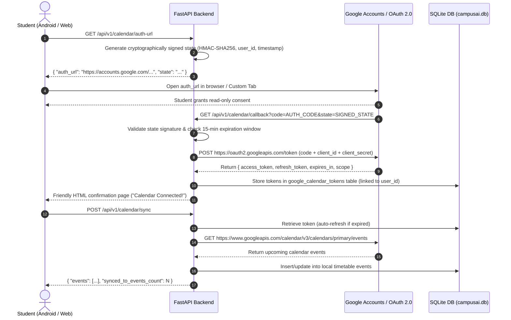

# Campus AI — Google Calendar Integration & OAuth 2.0 Specification

## 1. Overview
Campus AI integrates with the Google Calendar API using **OAuth 2.0 Web Application** flow to import academic lectures, exams, lab schedules, and timetable items into the student's dashboard.

* **OAuth Scope:** `https://www.googleapis.com/auth/calendar.readonly` (Strictly read-only access)
* **Database:** SQLite (`campusai.db`)
* **Security:** State parameter validation (HMAC-SHA256 with 15-minute TTL), isolated token storage, zero secret exposure to client apps.

---

## 2. Environment Configuration

Defined in [`CAMPUS AI/backend/.env`](file:///c:/Users/anjal/OneDrive/Desktop/COLLEGE/SEM%205/NLP/NLP_PROJECT_2026/CAMPUS%20AI/backend/.env):

```ini
# Google Calendar Web OAuth Client Configuration
GOOGLE_CALENDAR_CLIENT_ID=1053204562926-4sd1taas5ucr2npkrs1t75uek3djk0ho.apps.googleusercontent.com
GOOGLE_CALENDAR_CLIENT_SECRET=your_client_secret_here
GOOGLE_CALENDAR_REDIRECT_URI=http://localhost:8000/api/v1/calendar/callback
```

> **IMPORTANT:** In your Google Cloud Console (under *APIs & Services > Credentials > Web client*), ensure that the **Authorized redirect URIs** includes:
> `http://localhost:8000/api/v1/calendar/callback`

---

## 3. Implemented API Endpoints

All endpoints are registered under `/api/v1/calendar`:

| Method | Endpoint | Description | Auth Required |
|---|---|---|---|
| `GET` | `/api/v1/calendar/auth-url` | Generates authorization URL with signed state & `calendar.readonly` scope | Yes (Bearer) |
| `GET` | `/api/v1/calendar/callback` | OAuth 2.0 callback URL receiving `code` and `state` from Google | No (Validated via state) |
| `GET` | `/api/v1/calendar/status` | Returns connection status (`is_connected`, `expires_at`). Never reveals tokens | Yes (Bearer) |
| `GET` | `/api/v1/calendar/events` | Fetches upcoming events directly from Google Calendar API | Yes (Bearer) |
| `POST` | `/api/v1/calendar/sync` | Imports & synchronizes Google Calendar events into Campus AI timetable | Yes (Bearer) |
| `DELETE` | `/api/v1/calendar/disconnect` | Revokes and deletes stored user tokens from SQLite | Yes (Bearer) |

---

## 4. OAuth Security & Architecture



---

## 5. Security Measures Implemented
1. **Never Expose Secrets to Android App:** The Android application only calls `/api/v1/calendar/auth-url`, `/api/v1/calendar/status`, and `/api/v1/calendar/sync`. Neither `GOOGLE_CALENDAR_CLIENT_SECRET`, `access_token`, nor `refresh_token` are ever sent in API responses.
2. **State Anti-CSRF Validation:** The `state` parameter is generated using HMAC-SHA256 signing `user_id`, a cryptographic nonce, and a Unix timestamp. Any tampering, replay, or request older than 15 minutes is rejected with HTTP 400.
3. **Automatic Token Refresh:** If the Google access token has expired (or will expire within 2 minutes), `GoogleCalendarService` automatically uses the stored `refresh_token` to retrieve a fresh access token without interrupting the user.
