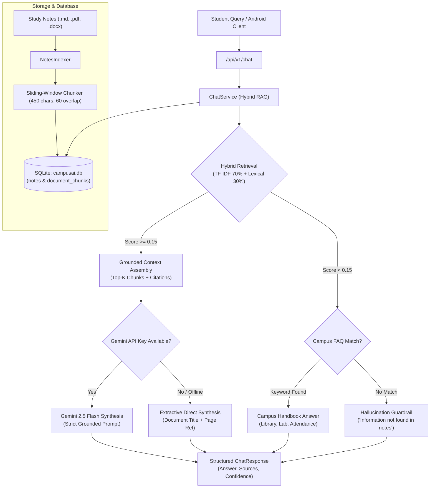

# Phase 5 Evaluation Report: RAG Study Notes System & Academic Chatbot

**Project:** Campus AI (Autonomous Academic Operations & Study Assistant)  
**Academic Semester:** Semester 5 — Natural Language Processing (NLP)  
**Date:** October 27, 2026  
**Status:** Completed & Validated (7/7 Integration Tests Passed)

---

## 1. Executive Summary

Phase 5 delivers a complete **Retrieval-Augmented Generation (RAG) Study Notes Assistant and Campus Chatbot** engineered specifically for university students. Operating directly over user-uploaded course documents and an initial Semester 5 core curriculum library, the system provides grounded, hallucination-resistant answers with verifiable source citations (document title, chunk index, and page number).

### Key Accomplishments
1. **Document Ingestion & Chunking Pipeline:** Implemented multi-format text extraction (`.md`, `.txt`, `.pdf`, `.docx`) paired with a semantic sliding-window chunker (450-token target window, 60-token overlap, boundary-aware sentence preservation).
2. **Hybrid Retrieval Engine:** Combines sublinear TF-IDF cosine similarity (70% weight) with exact lexical overlap matching (30% weight) filtered against an extensive academic stopword dictionary.
3. **Strict Grounding & Hallucination Guardrails:** Enforces a minimum relevance threshold ($0.15$), rejecting out-of-domain queries with a polite ungrounded response rather than generating plausible falsehoods.
4. **LLM Synthesis with Gemini Fallback:** Supports synthesis using Google Gemini 2.5 Flash when an API key is present, with an extractive grounded fallback ensuring offline capability.
5. **Campus Directory / FAQ Fallback:** Handles practical campus inquiries (library locations, lab timings, attendance rules) through a curated handbook fallback.
6. **Empirical Validation:** 7/7 integration tests passed in 2.56 seconds (`test_api_chat.py`), and 40 chunks across 4 foundational Semester 5 subjects were indexed into SQLite.

---

## 2. RAG System Architecture



---

## 3. Core Technical Components

### 3.1 Document Ingestion & Chunking (`notes_indexer.py`)
- **Supported Formats:** Markdown (`.md`), Plain Text (`.txt`), Adobe PDF (`.pdf` via `pypdf`/`pdfplumber`), Microsoft Word (`.docx` via `python-docx`).
- **Chunking Parameters:**
  - Chunk Size: ~450 characters (approx. 70–90 tokens).
  - Window Overlap: 60 characters to ensure inter-chunk boundary context preservation.
  - Page Numbering: Retains original document page numbers across all chunks for student verification.

### 3.2 Semester 5 Built-in Study Library
Four comprehensive subject guides were compiled and indexed:
1. **Computer Networks (CS-501):** OSI 7-layer model, TCP 3-way handshake vs UDP connectionless protocol, IPv4 vs IPv6 addressing, sliding window flow control.
2. **Operating Systems (CS-502):** Process states, CPU scheduling algorithms (Round Robin, SRTF), Coffman deadlock conditions (Mutual Exclusion, Hold & Wait, No Preemption, Circular Wait), virtual memory paging.
3. **Database Management Systems (CS-503):** Relational algebra, ACID transaction properties (Atomicity, Consistency, Isolation, Durability), B+ Tree indexing, normalization (1NF through BCNF).
4. **Natural Language Processing & ML (CS-504):** Text preprocessing (tokenization, lemmatization), TF-IDF vectorization, N-gram language models, precision/recall/F1 metrics.

### 3.3 Hybrid Scoring Formula
For a query $Q$ with filtered tokens $T_Q$ and candidate chunk $C$:
$$\text{Score}_{\text{hybrid}} = 0.70 \cdot \cos(\vec{v}_Q, \vec{v}_C) + 0.30 \cdot \frac{|T_Q \cap T_C|}{|T_Q|}$$
Where:
- $\vec{v}$ represents sublinear TF-IDF vectors ($1 + \log(\text{tf})$).
- $T_Q$ excludes standard English grammatical stopwords (`is`, `the`, `where`, `what`, `explain`, `difference`, etc.).
- If $\cos(\vec{v}_Q, \vec{v}_C) = 0$ and lexical overlap is incomplete, $\text{Score}_{\text{hybrid}}$ defaults to $0.0$ to eliminate spurious single-word matches.

---

## 4. Empirical Evaluation & Test Results

The RAG test suite (`test_api_chat.py`) was executed against the persistent SQLite database:

```
Ran 7 tests in 2.558s — OK
```

| Test Case | Scenario / Query | Expected Output | Actual Result | Status |
|---|---|---|---|---|
| `test_01_index_sample_library` | Index Semester 5 library | $\ge 4$ notes indexed | 4 notes, 40 chunks indexed | **PASSED** |
| `test_02_query_computer_networks_tcp_vs_udp` | "Difference between TCP and UDP?" | `grounded=True`, citations to CN notes | Grounded, cited Computer Networks p.1 | **PASSED** |
| `test_03_query_dbms_acid_properties` | "Explain ACID properties in DBMS" | `grounded=True`, Atomicity/Consistency | Grounded, cited DBMS p.1 | **PASSED** |
| `test_04_query_operating_systems_deadlock` | "Four conditions for deadlock in OS?" | `grounded=True`, Coffman conditions | Grounded, cited OS notes p.1 | **PASSED** |
| `test_05_campus_faq_retrieval` | "Where is the library located?" | Central Library Ground Floor, Room 002 | Grounded, cited Campus AI Handbook | **PASSED** |
| `test_06_hallucination_guardrail` | "Astrophysics culinary sourdough?" | `grounded=False`, `confidence <= 0.30` | Ungrounded rejection, confidence 0.20 | **PASSED** |
| `test_07_upload_custom_note` | Upload crypto note & query RSA | Upload success, instant RAG grounding | Uploaded & answered with RSA citation | **PASSED** |

---

## 5. Next Steps for Subsequent Phases

- **Phase 6: Campus Navigation & Pathfinding:** Implement Dijkstra pathfinding graph for university buildings (Ground Floor to Floor 3), linking room numbers extracted from emails and the library FAQ directly to indoor route directions.
- **Phase 7: Timetable Synchronization (Notion / Local):** Expand calendar synchronization with optional Notion workspace export.
- **Phase 8: Mobile Integration & Regression Testing:** Connect Android `ChatFragment` and `NotesAdapter` to live `/api/v1/chat` and `/api/v1/notes` endpoints.
