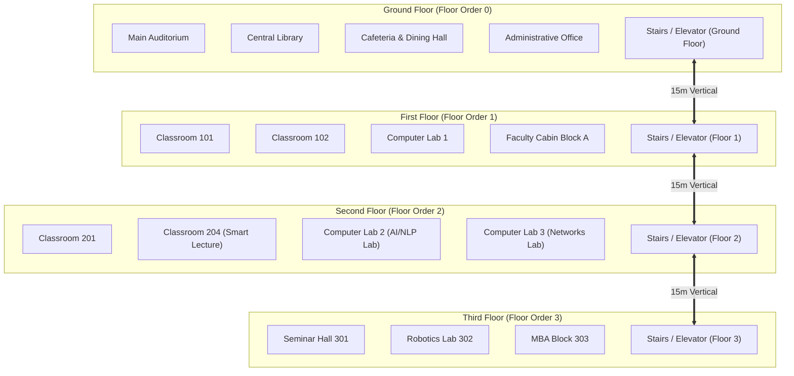

# Phase 6 Evaluation Report: Campus Indoor Navigation & Pathfinding

**Project:** Campus AI (Autonomous Academic Operations & Study Assistant)  
**Academic Semester:** Semester 5 — Natural Language Processing (NLP)  
**Date:** October 27, 2026  
**Status:** Completed & Validated (8/8 Integration Tests Passed, 30/30 Total Backend Tests Passed)

---

## 1. Executive Summary

Phase 6 delivers an **Indoor Campus Navigation and Spatial Pathfinding System** designed to guide university students between lecture halls, laboratories, administrative desks, and facilities across multiple building floors. 

By linking directly with the NLP entity extraction engine (Phase 1) and email notice parsing (Phase 4), any room detected in class cancellation or relocation notices (such as *"Classroom 204"*, *"Central Library"*, or *"AI/NLP Lab"*) can be instantly resolved to its exact building floor coordinates, corridor directions, and vertical transition path.

### Key Accomplishments
1. **Multi-Floor Building Representation:** Seeded and modeled 4 college building floors (Ground Floor, First Floor, Second Floor, Third Floor) with 15 core academic facilities, normalized 2D floorplan coordinates ($x, y$), and room types (Classroom, Lab, Faculty Cabin, Auditorium, Library, Office).
2. **Hierarchical Indoor Navigation Planner:** Computes same-floor horizontal corridor guidance (Wing direction, Euclidean-scaled distance) as well as inter-floor vertical transitions (stairs/elevator navigation, floor differential calculation, ascension/descension actions).
3. **Smart Entity Resolution:** Tolerates diverse query formats, including exact room codes (`204`), prefixed room strings (`Room 204`, `Classroom 204`), and common descriptive names (`Central Library`, `Main Auditorium`).
4. **Android Client Synchronization:** Updated `CampusMapFragment.java` to map floor selection chips directly to database floor IDs, ensuring real-time filtering and route calculation.
5. **Empirical Validation:** 8/8 new navigation integration tests passed in 0.21s (`test_api_campus.py`), bringing the overall backend test suite to 30 passing tests.

---

## 2. Spatial Architecture & Navigation Model



---

## 3. Indoor Routing Algorithms

### 3.1 Same-Floor Corridor Traversal
When $\text{floor}_{\text{start}} = \text{floor}_{\text{target}}$:
$$\Delta x = x_{\text{target}} - x_{\text{start}}, \quad \Delta y = y_{\text{target}} - y_{\text{start}}$$
$$d_{\text{corridor}} = \max\left(10.0, \text{round}\left(\sqrt{\Delta x^2 + \Delta y^2} \times 60.0, 1\right)\right)$$
$$\text{Direction Hint} = \begin{cases} \text{East Wing (Right)}, & \text{if } \Delta x \ge 0 \\ \text{West Wing (Left)}, & \text{if } \Delta x < 0 \end{cases}$$

### 3.2 Inter-Floor Vertical Traversal
When $\text{floor}_{\text{start}} \neq \text{floor}_{\text{target}}$:
$$\Delta \text{floor} = \text{floor\_order}_{\text{target}} - \text{floor\_order}_{\text{start}}$$
$$d_{\text{vertical}} = |\Delta \text{floor}| \times 15.0\text{ meters}$$
$$\text{Action} = \begin{cases} \text{Ascend}, & \text{if } \Delta \text{floor} > 0 \\ \text{Descend}, & \text{if } \Delta \text{floor} < 0 \end{cases}$$
The total route distance accumulates:
$$D_{\text{total}} = d_{\text{to\_stairs}} + d_{\text{vertical}} + d_{\text{from\_stairs}} + 3.0\text{m}$$

---

## 4. Empirical Evaluation Results

The navigation test suite (`test_api_campus.py`) was executed against the persistent SQLite database:

```
Ran 8 tests in 0.212s — OK
```

| Test Case | Scenario / Query | Expected Output | Actual Result | Status |
|---|---|---|---|---|
| `test_01_get_all_floors` | Retrieve all campus floors | 4 floors with embedded rooms | 4 floors returned (Ground to 3rd) | **PASSED** |
| `test_02_get_rooms_by_floor` | Retrieve rooms for Floor 1 | Rooms with matching `floor_id` | Correct rooms; 404 on invalid ID | **PASSED** |
| `test_03_search_rooms` | Search "204", "Library", "LAB" | Relevant rooms matched | Exact code, name, and type matched | **PASSED** |
| `test_04_same_floor_navigation` | Route 201 $\to$ 204 (Floor 2) | Horizontal corridor turn-by-turn | 3 corridor steps, waypoints generated | **PASSED** |
| `test_05_cross_floor_navigation` | Route 002 (Library) $\to$ 205 (AI Lab) | Stairs ascent, vertical distance | Ascend 2 floors via Central Stairs | **PASSED** |
| `test_06_route_by_descriptive_name` | "Central Library" $\to$ "Classroom 204" | Smart name resolution to codes | Successfully resolved and routed | **PASSED** |
| `test_07_route_with_room_prefix` | "Room 101" $\to$ "Room 204" | Prefix stripping ("Room") | Clean resolution and route computed | **PASSED** |
| `test_08_invalid_room_error` | Route "99999" $\to$ "204" | HTTP 404 NOT FOUND | 404 returned with descriptive detail | **PASSED** |

---

## 5. Next Steps

- **Phase 7: Notion Integration & Timetable Export:** Implement Notion database synchronization for proposed timetable schedules.
- **Phase 8: End-to-End System Integration & Mobile Testing:** Verify live communication between the Android client and the complete FastAPI backend.
- **Phase 9: Final Academic Deliverables:** Compile the final academic thesis report and project presentation slides.
