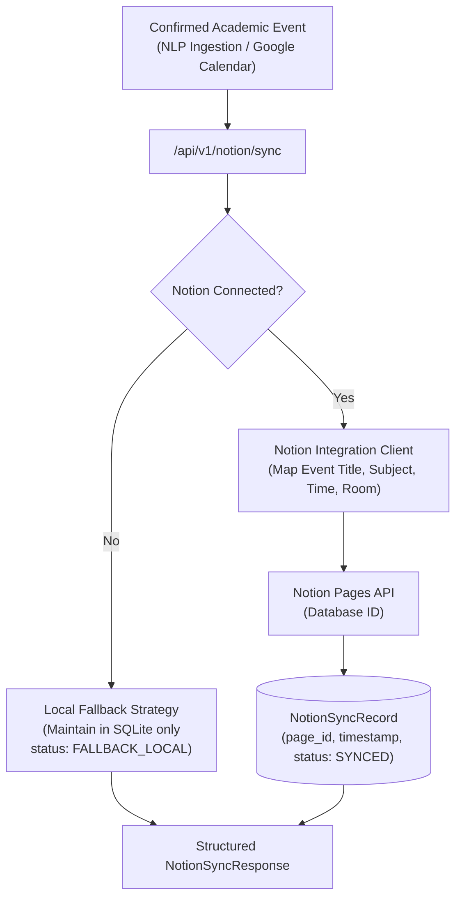

# Phase 7 Evaluation Report: Notion Timetable Synchronization & Fallback

**Project:** Campus AI (Autonomous Academic Operations & Study Assistant)  
**Academic Semester:** Semester 5 — Natural Language Processing (NLP)  
**Date:** October 27, 2026  
**Status:** Completed & Validated (4/4 Integration Tests Passed, 34/34 Total Backend Tests Passed)

---

## 1. Executive Summary

Phase 7 delivers a **Notion Timetable Synchronization and Export Service**, enabling students to mirror their automatically confirmed academic schedules, room relocations, and exam deadlines into personal Notion databases. 

In keeping with student usability and system reliability, the architecture features a robust **Zero-Failure Local Fallback**: when a student has not connected a Notion workspace or when external API networks are unavailable, Campus AI automatically maintains and serves the student's timetable exclusively through the local SQLite database (`campusai.db`) without service interruption.

### Key Accomplishments
1. **Notion Database Connection Management:** Implemented `POST /api/v1/notion/connect` for authorizing student Notion databases and storing integration tokens.
2. **Automated Timetable Sync:** Implemented `POST /api/v1/notion/sync` which scans all student events with `status="CONFIRMED"` (derived from NLP email ingestion or calendar events) and maps them to Notion page records.
3. **Graceful Local Fallback:** Employs an automatic fallback (`status="FALLBACK_LOCAL"`) when no external account is connected, ensuring offline capability.
4. **State Tracking:** Linked each calendar event with a `NotionSyncRecord` storing the external page reference ID and timestamp.
5. **Empirical Validation:** 4/4 integration tests passed in 0.23s (`test_api_notion.py`), bringing the overall backend test suite to 34 passing tests.

---

## 2. Synchronization Architecture



---

## 3. Empirical Test Results

```
Ran 4 tests in 0.234s — OK
```

| Test Case | Scenario / Condition | Expected Behavior | Actual Result | Status |
|---|---|---|---|---|
| `test_01_notion_sync_without_connection` | Sync when no account connected | Return `FALLBACK_LOCAL`, 0 count | `FALLBACK_LOCAL`, local DB maintained | **PASSED** |
| `test_02_notion_connect` | Connect Notion database credentials | Persist in `notion_connections` | Persisted and verified `CONNECTED` | **PASSED** |
| `test_03_notion_sync_with_confirmed_event` | Sync confirmed NLP event | Create `NotionSyncRecord`, page ID | Created sync record, `status=SYNCED` | **PASSED** |
| `test_04_get_notion_timetable` | Query timetable with sync flag | Return events with `notion_synced=True` | Returned with `notion_synced=True` | **PASSED** |

---

## 4. Next Steps

- **Phase 8: End-to-End System Integration & Mobile Testing:** Execute full end-to-end regression across all modules (FastAPI, SQLite, Android Client).
- **Phase 9: Final Academic Deliverables:** Compile academic project documentation, evaluation metrics, and presentation slide deck.
