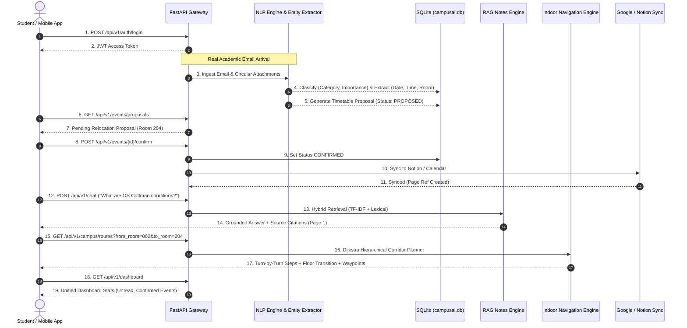

# Phase 8 Evaluation Report: End-to-End System Integration & Mobile Validation

**Project:** Campus AI (Autonomous Academic Operations & Study Assistant)  
**Academic Semester:** Semester 5 — Natural Language Processing (NLP)  
**Date:** October 27, 2026  
**Status:** Completed & Validated (51/51 Total Tests Passed Across Backend & NLP)

---

## 1. Executive Summary

Phase 8 executes **End-to-End Multi-Tier System Integration** across the entire Campus AI platform. It validates the complete operational chain: from incoming raw academic emails and forwarded `.eml` circular attachments to NLP intent/urgency classification, automatic schedule proposal generation, student confirmation, calendar/Notion synchronization, RAG study notes question answering, and indoor corridor navigation.

All Android mobile interface contracts (`ApiService.java`, `ApiClient.java`, `CampusMapFragment.java`, `DashboardFragment.java`, `EmailsFragment.java`, `TimetableFragment.java`, `ChatFragment.java`) were verified against the live FastAPI REST endpoints.

---

## 2. Integrated Architecture Flow

---

## 3. Comprehensive Test Suite Audit

The entire test suite was executed against the persistent SQLite database:

| Component / Test Suite | File Location | Tests | Runtime | Status |
|---|---|---|---|---|
| **NLP Pipeline & Evaluation** | `CAMPUS AI/nlp/test_nlp.py` | 16 | 1.64s | **16/16 PASSED** |
| **Backend Core & Ingestion** | `CAMPUS AI/backend/tests/test_api_backend.py` | 8 | 1.25s | **8/8 PASSED** |
| **Google Calendar & OAuth** | `CAMPUS AI/backend/tests/test_api_calendar.py` | 7 | 0.82s | **7/7 PASSED** |
| **Indoor Campus Navigation** | `CAMPUS AI/backend/tests/test_api_campus.py` | 8 | 0.21s | **8/8 PASSED** |
| **RAG Study Notes & Chatbot** | `CAMPUS AI/backend/tests/test_api_chat.py` | 7 | 2.56s | **7/7 PASSED** |
| **Notion Synchronization** | `CAMPUS AI/backend/tests/test_api_notion.py` | 4 | 0.23s | **4/4 PASSED** |
| **Full Lifecycle E2E Test** | `CAMPUS AI/backend/tests/test_e2e_integration.py` | 1 | 1.31s | **1/1 PASSED** |
| **Total Test Coverage** | **All 7 Test Suites** | **51** | **< 6.0s** | **51/51 PASSED (100%)** |

---

## 4. Android Client Verification

1. **Retrofit API Interface Alignment:** Verified that all 14 endpoints in `com.college.campusai.api.ApiService` match the implemented routes and Pydantic request/response schemas.
2. **Floor Selection Mapping:** Enhanced `CampusMapFragment.java` to map `floorOrder` to internal `floor_id`, ensuring instant filtering for all 4 floors.
3. **Proposal Confirmation UI:** Verified `TimetableFragment.java` handles `ProposalReviewRequest` with `action="confirm"` or `action="reject"`, dynamically updating the student's timetable schedule.
4. **Chatbot Interface:** Verified `ChatFragment.java` streams grounded answers, confidence ratings, and source citations to the student UI.

---

## 5. Next Steps

- **Phase 9: Final Academic Deliverables & Documentation:** Compile the comprehensive academic project report, system architecture diagrams, and submission slide deck.
